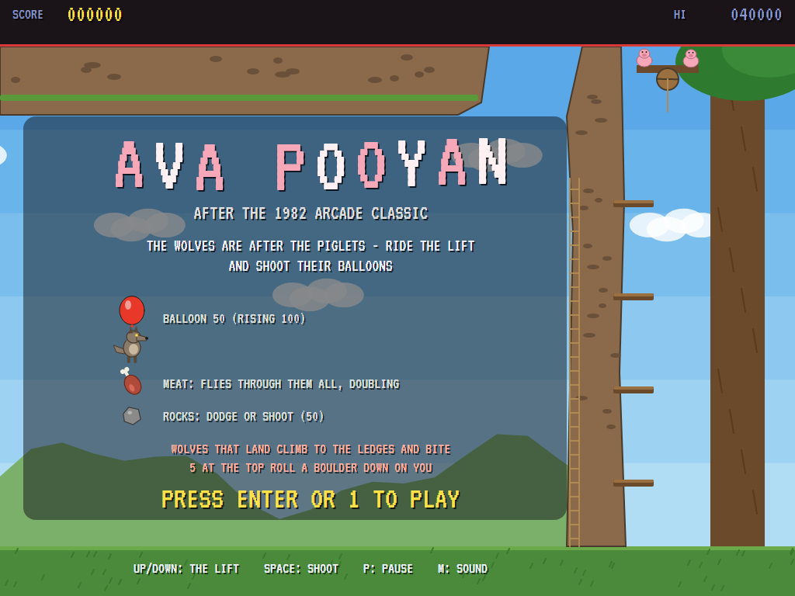
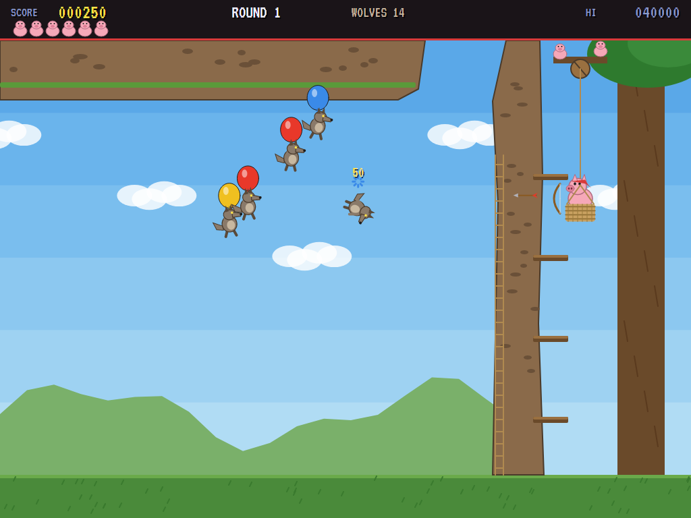
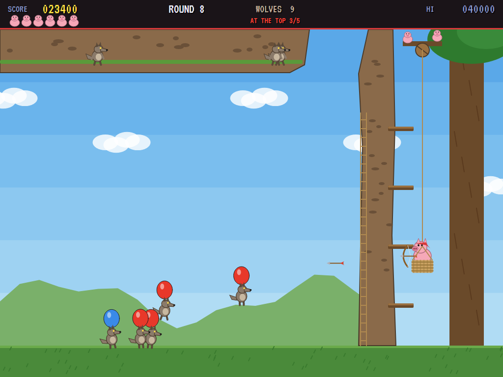
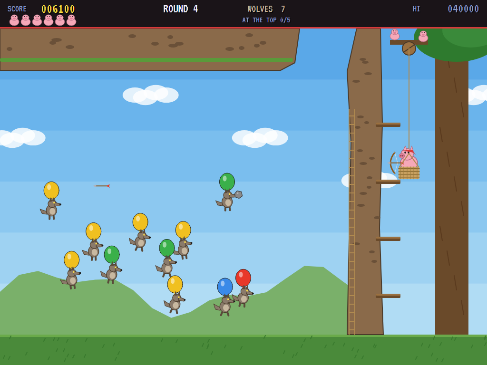
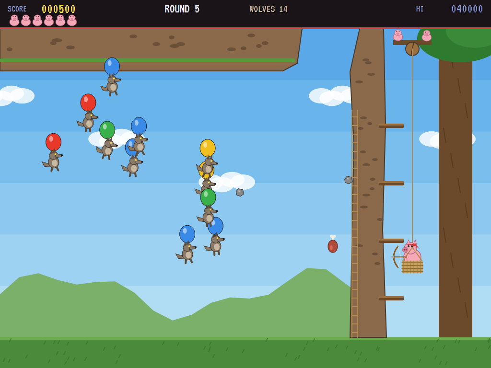
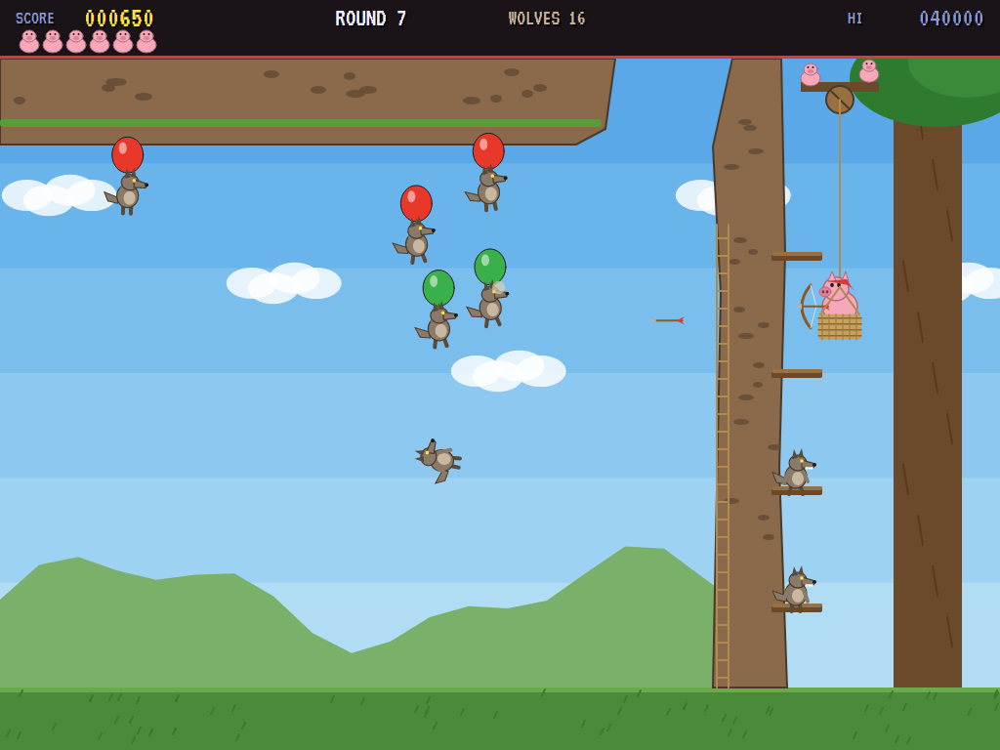
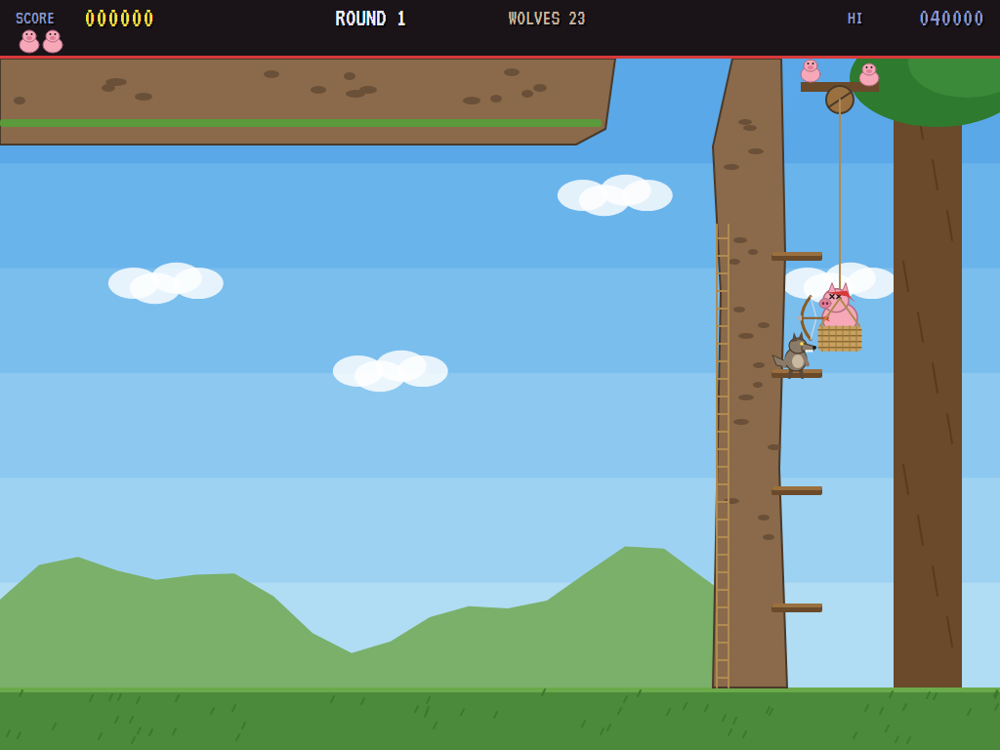
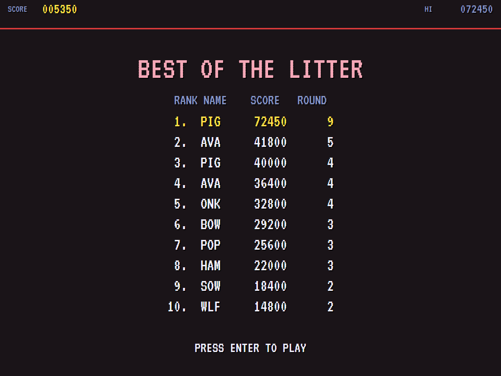

# AVA Pooyan

[](https://github.com/Harlock123/AVAPooyan/actions/workflows/build.yml)

A balloon-popping shooter in the style of Konami's 1982 arcade game **Pooyan**, built with .NET 10 and Avalonia
UI. The wolves are after the piglets. The mother pig rides a lift up and down the cliff, hauled by two of her
piglets at the pulley, and shoots arrows across the valley at the wolves' balloons. Pop a balloon and the wolf
drops like a stone. Miss, and the wolves get to her.

## Features

- **Down rounds** (the odd ones): the wolves float down off the clifftop on balloons. A wolf that reaches the
  ground runs to the cliff, climbs the rope ladder and stands on a ledge beside the shaft. Bring the lift
  level with a ledge wolf and it bites. Any more than four wait at the foot of the cliff.
- **Up rounds** (the even ones): the wolves float up from the ground, worth double. Every wolf that reaches the
  clifftop waits there. When five have made it, they roll a boulder along the top and down the shaft.
- **Arrows** fly straight across, two at a time. Hit the balloon, not the wolf: an arrow that hits the wolf
  itself is turned aside.
- **Meat**: every so often the pig has a chunk of meat to throw. It flies on through every balloon in its
  path, and each one is worth double the one before.
- **Rocks**: the floating wolves lob rocks at the lift. Dodge them, or shoot them down (50).
- **Each round** ends when every wolf has been dealt with. That's 1,000, and 2,000 more if not one got
  through. Later rounds bring more wolves, more often, faster, and throwing more. There's an extra pig every
  30,000.
- **The attract mode** plays itself. The computer player picks the most pressing balloon (the lowest when the
  wolves are coming down, the highest when they're going up), works out where it will be when an arrow gets
  there, and takes the lift to that height to shoot. It keeps clear of the ledge wolves and the rocks.
- **The sounds** are all synthesised: the bow's twang, balloon pops, falling wolves, growls, the boulder's
  rumble, and a cheerful oom-pah tune.

## Screenshots

| The title | Coming down | Going up |
|:---------:|:-----------:|:--------:|
|  |  |  |
| The valley, and the rules. | Off the clifftop. | Up from the ground. |

| A rock | The meat | On the ledges |
|:------:|:--------:|:-------------:|
|  |  |  |
| Lobbed at the lift. | Through the lot of them. | Two waiting to bite. |

| Bitten | The high scores | |
|:------:|:---------------:|:-:|
|  |  | |
| Too close to a ledge. | The best of the litter. | |

The screenshots are made by the tests, which play the game in a real (headless) window; see
[Tests](#tests).

## Download and run

Ready-to-run builds for Windows, macOS and Linux, on both Intel/AMD and ARM, are on the
[Releases page](https://github.com/Harlock123/AVAPooyan/releases/tag/latest). **Latest build** is
rebuilt on every push to `main`. Each download is one self-contained executable: no .NET install is
needed.

| Platform | Archive |
|---|---|
| Windows | `AVAPooyan-win-x64.zip`, `AVAPooyan-win-x86.zip`, `AVAPooyan-win-arm64.zip` |
| macOS | `AVAPooyan-osx-arm64.tar.gz` (Apple silicon), `AVAPooyan-osx-x64.tar.gz` (Intel) |
| Linux | `AVAPooyan-linux-x64.tar.gz`, `AVAPooyan-linux-arm64.tar.gz`, `AVAPooyan-linux-arm.tar.gz` |

```bash
tar -xzf AVAPooyan-linux-x64.tar.gz     # or linux-arm64, linux-arm, osx-arm64, osx-x64
./AVAPooyan
```

On Windows, unzip and run `AVAPooyan.exe`. On macOS, if Gatekeeper refuses to open it, run
`xattr -d com.apple.quarantine AVAPooyan` once. Run with `--no-audio` for silence.

**Sound** comes through OpenAL Soft, built in for every platform. In a virtual machine the game
detects it and uses a larger audio buffer, so the sound doesn't break up.

**Gamepads** use SDL2, which is bundled for Windows, macOS and Intel/AMD Linux. ARM Linux builds need it
installed; without it the keyboard still works:

```bash
sudo apt install libsdl2-dev            # Debian / Ubuntu / Raspberry Pi OS
sudo pacman -S --needed sdl2-compat     # Arch / Omarchy
```

## Controls

| Action | Keyboard | Gamepad |
|---|---|---|
| Start | Enter or 1 | Start |
| The lift up and down | Up and down arrows (or W and S) | Left stick / D-pad |
| Shoot | Space, Z, X, Ctrl or the left arrow | A, B or right trigger |
| Pause | P or Esc | Start |
| Quit (while paused) | Esc | Back |
| Sound on/off | M | |
| Screenshot | Ctrl+S (to your Pictures folder) | |

On the high-score table, type your initials, or use up/down and Space, then Enter.

## Tests

```bash
dotnet test AVAPooyan.slnx
```

The engine has no UI and runs in fixed 60 Hz steps, so it plays the same at any frame rate, and a seed
always plays the same game. The tests check:

- **The pig:** the lift up and down its shaft and no further; arrows across, two at a time; a balloon popped
  and the wolf falling, and an arrow turned aside by the wolf itself; rising balloons worth double; the meat
  flying through every balloon, doubling, and coming round every so often
- **The wolves:** down rounds off the clifftop and up rounds off the ground; a wolf landing, climbing to a
  ledge and biting; waiting at the foot with every ledge taken; five at the top and the boulder; rocks
  thrown at the lift, and shot down
- **The machine:** a round's end, with the perfect bonus; later rounds harder; extra pigs; the last pig lost,
  and initials; the title, demonstration and high scores, and starting a game; the keys; the computer player
  through the first two rounds, and riding up and down firing all the time losing

The screenshot tests draw the real screen in a headless window. To refresh the README's pictures:

```bash
POOYAN_SHOTS=$PWD/Images dotnet test tests/AVAPooyan.Tests --filter ScreenshotTests
```

To see how the computer player gets on, round by round (`1` for the player, `lazy` for one that rides the lift
up and down firing all the time):

```bash
POOYAN_PROBE=1 dotnet test tests/AVAPooyan.Tests --filter PilotProbe --logger "console;verbosity=detailed"
```

## Building

```bash
dotnet build AVAPooyan.slnx
dotnet run --project src/AVAPooyan
```

Needs the .NET 10 SDK. The sounds are made by `tools/make_sounds.py` (standard-library Python):
`python3 tools/make_sounds.py` rewrites `src/AVAPooyan/Sounds`.

## Project structure

```
AVAPooyan/
├── AVAPooyan.slnx
├── src/AVAPooyan/
│   ├── Engine/
│   │   ├── GameEngine.cs        # States, the title and demo cycle, the music
│   │   ├── GameEngine.Play.cs   # The lift and the bow, the wolves up and down, meat, rocks, ledges and the boulder
│   │   ├── PigPilot.cs          # The computer player, for the demonstration (and the tests)
│   │   ├── Entities.cs          # The valley, the pig, the wolves and everything they throw
│   │   ├── HighScoreTable.cs, InitialsEntry.cs
│   │   ├── InputHandler.cs, ControllerManager.cs  # Keys and an SDL2 gamepad
│   │   └── SoundManager.cs      # Effects and the tunes through OpenAL
│   ├── Audio/                   # The OpenAL engine (from the author's AVABand)
│   ├── Views/                   # The drawing: the valley, the pig and her lift, the wolves, the screens
│   └── Sounds/                  # The synthesised effects and tunes
├── tests/AVAPooyan.Tests/       # Gameplay, screenshot and probe tests
├── tools/make_sounds.py
└── Images/                      # Screenshots
```

## About and licence

AVA Pooyan © 2026 Lonnie Watson, under the [MIT License](LICENSE).

*Pooyan* © 1982 Konami; the name belongs to its current owner. AVA Pooyan is an independent, unofficial game
in its style. Its pigs, wolves and valley, its graphics, sounds, tunes and code are its own; nothing is taken
from the arcade machine's program, graphics, sound or music. It is not affiliated with or endorsed by any
rights holder.
